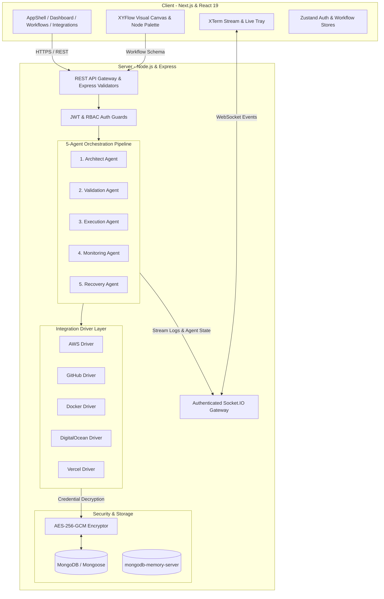

# InfraFlow AI

**InfraFlow AI** is an Agentic DevOps and Cloud Infrastructure Automation Platform. It turns natural-language requirements and visual node graphs into structured, executable, multi-cloud deployment pipelines orchestrated by a collaborative 5-agent AI team with real-time terminal streaming and automated self-healing.

**Live Demo:** [https://infraflow-ai.vercel.app](https://infraflow-ai.vercel.app/)

---

## Table of Contents
- [Problem Statement](#problem-statement)
- [Key Features](#key-features)
- [System Architecture](#system-architecture)
- [The 5-Agent Collaborative Workflow](#the-5-agent-collaborative-workflow)
- [AI & Google Gemini Integration](#ai--gemini-integration)
- [Supported Integration Drivers](#supported-integrations)
- [Security Architecture](#security-architecture)
- [Tech Stack](#tech-stack)
- [Project Structure](#project-structure)
- [Setup and Run Instructions](#setup-and-run-instructions)
- [Environment Variables](#environment-variables)
- [End-to-End Demo Workflow](#demo-workflow)
- [Testing & Quality Assurance](#testing-results)
- [Known Limitations & Future Roadmap](#known-limitations)

---

## Problem Statement
Modern cloud infrastructure deployment is error-prone, fragmented across disparate provider interfaces (AWS, GitHub, Docker, DigitalOcean, Vercel), and requires substantial manual YAML/CLI scripting. When provisioning pipelines fail mid-flight, developers and SREs spend hours troubleshooting logs without intelligent self-healing or validation safeguards.

**InfraFlow AI** solves this by combining:
1. **Interactive Visual DAG Flow Builders** paired with Gemini-powered natural-language infrastructure generators.
2. **Deterministic, Multi-Agent Orchestration** ensuring every task is planned, validated against security policies, executed safely, monitored, and auto-recovered upon failure.
3. **Encrypted Zero-Trust Credential Management** ensuring multi-cloud provider tokens are isolated per-tenant and never exposed in logs or client-side bundles.

---

## Key Features
- **Visual Drag-and-Drop Workflow Canvas:** Powered by `@xyflow/react`, supporting node palletization, configurable provider properties, dynamic handle connections, and instant graph serialization.
- **AI Infrastructure Generator:** Converts natural language prompts (e.g., *"Deploy a Node.js repository from GitHub with Docker on AWS EC2 behind Nginx"*) into complete directed acyclic graph (DAG) nodes and edges.
- **5-Agent Autonomous Orchestration Engine:** Multi-stage execution pipeline featuring Architect, Validation, Execution, Monitoring, and Recovery agents.
- **Live Terminal & Telemetry Streaming:** Real-time bi-directional streaming over Socket.IO to an integrated `@xterm/xterm` dark-mode terminal tray and dedicated execution monitoring view.
- **Automated Self-Healing & Fallback Recovery:** The Recovery Agent diagnoses runtime failures, updates remediation strategies, and safely re-executes pending nodes.
- **Encrypted Multi-Cloud Integration Hub:** Connect AWS, GitHub, Docker, DigitalOcean, and Vercel credentials securely via AES-256-GCM encryption with masked frontend display.
- **Live Health & Telemetry Dashboard:** Aggregates real-time workflow statistics, deployment counts, success rates, provider connectivity, and platform agent readiness.

---

## System Architecture



---

## The 5-Agent Collaborative Workflow

When a workflow is deployed, the **Orchestrator** coordinates 5 specialized agents in sequence:

1. **Architect Agent (`architectAgent.js`):**
   - Ingests the workflow DAG (nodes and edges).
   - Validates node dependencies and constructs an optimized, deterministic topological execution plan.
2. **Validation Agent (`validationAgent.js`):**
   - Enforces security, schema, and policy checks on all node configurations and credentials.
   - Detects missing parameters, circular dependencies, or unauthorized operations before execution starts.
3. **Execution Agent (`executionAgent.js`):**
   - Retrieves encrypted credentials per user tenant.
   - Dispatches execution tasks to corresponding integration drivers (AWS, GitHub, Docker, DigitalOcean, Vercel).
   - Emits colorized ANSI log chunks directly to the execution stream.
4. **Monitoring Agent (`monitoringAgent.js`):**
   - Observes execution progress, records stage completion, tracks duration, and monitors node status updates.
5. **Recovery Agent (`recoveryAgent.js`):**
   - Triggered automatically if a step fails.
   - Analyzes execution error logs, synthesizes remediation steps, applies automated fallback policies, and triggers controlled retries.

---

## AI & Gemini Integration
- **SDK:** Uses `@google/genai` (Google Gen AI SDK) targeting the `gemini-2.5-flash` model.
- **Workflow Generation (`aiService.js` & `geminiService.js`):** Parses user-submitted prompts into strict JSON matching the InfraFlow workflow node/edge schema.
- **Failover & Fallback:** Includes heuristic template fallback and fallback generation modes to ensure UI workflows can always be drafted even during external API rate limits or network outages.
- **Testing Safety:** Unit and route test suites mock the `@google/genai` SDK completely, ensuring zero outbound external API calls and zero billing during CI/CD.

---

## Supported Integrations

| Provider | Supported Operations | Credential Format |
| :--- | :--- | :--- |
| **Amazon Web Services (AWS)** | EC2 instance provisioning, VPC/Security group configuration, infrastructure deployment. | Access Key ID, Secret Access Key, Region |
| **GitHub** | Repository cloning, branch inspection, CI/CD trigger dispatch. | Personal Access Token (PAT) |
| **Docker Engine** | Remote Docker socket connectivity, container build, run, and image management. | Docker Daemon Host / Socket URI |
| **DigitalOcean** | Droplet provisioning, VPC networking, managed volume management. | Personal Access Token (`dop_v1_...`) |
| **Vercel** | Serverless Next.js deployments, domain alias management, project deployment. | API Token, Optional Team ID |

---

## Security Architecture
- **AES-256-GCM Encryption:** Integration credentials are encrypted at rest using Galois/Counter Mode authenticated encryption (`server/src/utils/encryption.js`). Encryption keys are strictly stored server-side.
- **Credential Masking:** Secret keys and tokens are never returned in plaintext to the frontend or logged in terminal output. The client only sees masked representations (`••••••••`).
- **JWT & Role-Based Access Control (RBAC):** All API endpoints require authenticated JWT Bearer tokens. Supports roles (`admin`, `sre_operator`, `developer`).
- **Socket.IO Authentication & Execution Isolation:** Socket handshakes validate JWT auth tokens and verify user ownership of execution IDs before allowing room joins, preventing eavesdropping on deployment logs.
- **Data Isolation:** All database queries (`Workflow`, `Execution`, `Integration`) are strictly scoped to the authenticated `user._id`.
- **Security Headers & Validation:** Hardened with `helmet`, `cors`, and `express-validator` sanitation on incoming payloads.

---

## Tech Stack

### Client
- **Framework:** Next.js 16 (Pages router, React 19)
- **Styling:** Vanilla CSS design tokens (`globals.css`) with TailwindCSS utility support
- **State Management:** Zustand (`authStore.js`, `workflowStore.js`)
- **Workflow Canvas:** `@xyflow/react`
- **Terminal Emulator:** `@xterm/xterm` & `@xterm/addon-fit`
- **Real-time Client:** `socket.io-client`
- **Icons:** `lucide-react`

### Server
- **Runtime:** Node.js, Express.js
- **Database:** MongoDB & Mongoose (with `mongodb-memory-server` auto-fallback for zero-config setup)
- **Real-time:** Socket.IO
- **Security:** `jsonwebtoken`, `bcryptjs`, Node.js native `crypto` (AES-256-GCM), `helmet`, `cors`
- **AI Integration:** `@google/genai` (Gemini 2.5 Flash)
- **Testing:** Jest, Supertest, `jest-mock-extended`

---

## Project Structure

```
infraflow_ai/
├── client/                     # Frontend Next.js application
│   ├── src/
│   │   ├── components/         # Reusable UI components
│   │   │   ├── AppShell/       # Header, Sidebar, Navigation
│   │   │   ├── MetricGrid/     # HealthCard telemetry widgets
│   │   │   ├── ProtectedRoute/ # AuthGuard component
│   │   │   ├── Terminal/       # TerminalStream & BottomTerminalTray
│   │   │   └── WorkflowCanvas/ # Canvas, CustomNodes, Palette, NodeConfigPanel
│   │   ├── pages/              # Next.js Pages
│   │   │   ├── dashboard.js    # Live telemetry dashboard
│   │   │   ├── executions/     # Execution history & live terminal view
│   │   │   ├── integrations.js # Encrypted integrations hub
│   │   │   ├── login.js        # User authentication
│   │   │   ├── register.js     # User registration
│   │   │   └── workflows/      # Visual canvas & AI workflow builder
│   │   ├── services/           # Axios API client & Socket.IO singleton
│   │   ├── store/              # Zustand global state stores
│   │   └── styles/             # Global dark-mode design system
│   └── package.json
├── server/                     # Backend Node.js & Express API
│   ├── src/
│   │   ├── agents/             # 5-agent orchestration engine
│   │   │   ├── architectAgent.js
│   │   │   ├── validationAgent.js
│   │   │   ├── executionAgent.js
│   │   │   ├── monitoringAgent.js
│   │   │   ├── recoveryAgent.js
│   │   │   └── orchestrator.js
│   │   ├── config/             # DB, Socket.IO, and environment config
│   │   ├── controllers/        # Express route controllers
│   │   ├── integrations/       # Multi-cloud provider driver implementations
│   │   ├── middleware/         # Auth, RBAC, error, and validation middleware
│   │   ├── models/             # Mongoose schemas (User, Workflow, Execution, Integration)
│   │   ├── routes/             # REST API endpoint definitions
│   │   ├── services/           # Gemini AI & workflow generation services
│   │   └── utils/              # AES-256 encryption, logger, API response helpers
│   ├── server.js               # Main HTTP & WebSocket server entrypoint
│   └── package.json
└── README.md                   # Project documentation
```

---

## Setup and Run Instructions

### Prerequisites
- **Node.js:** v18.x or higher
- **npm:** v9.x or higher
- *(Optional)* MongoDB instance (if not provided, an in-memory MongoDB starts automatically).

---

### 1. Backend Server Setup
```bash
cd server

# Install dependencies
npm install

# Configure environment variables
cp .env.example .env

# Start development server (runs on http://localhost:5000)
npm run dev
```

### 2. Frontend Client Setup
```bash
cd client

# Install dependencies
npm install

# Start Next.js dev server (runs on http://localhost:3000)
npm run dev
```

### 3. Open the Application
Navigate to `http://localhost:3000` in your web browser. Register a new SRE/Operator account to begin.

---

## Environment Variables

### Server (`server/.env`)
```env
# Server Configuration
PORT=5000
NODE_ENV=development
CLIENT_URL=http://localhost:3000

# Database (Leave blank to use automatic in-memory MongoDB)
MONGO_URI=

# Authentication & Security
JWT_SECRET=your_jwt_secret_here
JWT_EXPIRES_IN=7d
CREDENTIAL_ENCRYPTION_KEY=your_32_byte_encryption_key_here

# Queue (Optional)
REDIS_URL=

# AI Provider API Keys
GEMINI_API_KEY=your_google_gemini_api_key_here
```

### Client (`client/.env.local`)
```env
NEXT_PUBLIC_API_URL=http://localhost:5000/api
NEXT_PUBLIC_SOCKET_URL=http://localhost:5000
```

---

## Demo Workflow

Follow these steps to experience the complete InfraFlow AI pipeline:

1. **Register / Login:** Create an account at `/register` or sign in at `/login`.
2. **Configure Cloud Integrations:** Navigate to `/integrations` and connect AWS, GitHub, Docker, DigitalOcean, or Vercel credentials. Credentials are saved encrypted with AES-256-GCM.
3. **Generate or Build a Workflow:**
   - Go to `/workflows/builder` and input an infrastructure prompt (e.g., *"Deploy Docker container from GitHub to AWS"*).
   - Alternatively, create a blank workflow and use the visual drag-and-drop canvas at `/workflows/[id]` to place and connect nodes.
4. **Deploy Graph:** Click **"Deploy Graph"** in the top bar of the canvas.
5. **Watch the 5-Agent Pipeline:**
   - The collapsible bottom terminal tray will expand automatically.
   - The **Architect Agent** builds the topological execution plan.
   - The **Validation Agent** verifies node schemas and credentials.
   - The **Execution Agent** runs each driver task and streams colorized ANSI logs live over Socket.IO.
   - The **Monitoring Agent** and **Recovery Agent** track completion and handle errors.
6. **Inspect Telemetry:** View completed execution summaries, durations, and agent states on `/dashboard` and `/executions/[id]`.

---

## Testing Results

The platform has been rigorously validated across automated backend test suites as well as end-to-end production verification:

### Automated Backend Test Suite
Executed via Jest across unit, integration, route, and end-to-end multi-agent test suites:

```bash
cd server
npm test
```

- **`src/services/geminiService.test.js`:** Tests `@google/genai` integration with mocked client methods.
- **`src/services/aiService.test.js`:** Tests workflow generation logic and schema enforcement.
- **`src/routes/aiRoutes.test.js`:** Tests AI REST API endpoints and error handling.
- **`src/agents/executionAgent.test.js`:** Tests credential retrieval, task execution, and log streaming across all 5 provider drivers.
- **`src/agents/orchestrator.e2e.test.js`:** Tests end-to-end 5-agent execution lifecycle and self-healing automated recovery.

```
Test Suites: 5 passed, 5 total
Tests:       63 passed, 63 total
Snapshots:   0 total
Time:        4.576 s
```

### Production End-to-End Verification
- **Production Registration & Login:** Verified on live production deployment (`https://infraflow-ai.vercel.app` against Render backend API).
- **AI Workflow Generation:** Natural language prompt interpretation generates syntactically valid DAG nodes and dependency edges.
- **Workflow Persistence:** Workflows correctly persist across sessions with full MongoDB Atlas document storage.
- **Successful Workflow Execution:** Real-time multi-agent execution pipeline runs through Architect, Validation, Execution, and Monitoring phases with streaming ANSI terminal output.
- **Execution History:** Execution runs, status transitions, duration metrics, and agent logs are recorded and inspectable via the dedicated executions view.
- **Multi-User Data Isolation:** Verified with secondary user accounts; workflows are correctly partitioned and inaccessible across user accounts.

---

## Known Limitations

- **Simulated Provider Operations:** Provider deployment operations (`awsIntegration`, `githubIntegration`, `dockerIntegration`, `digitaloceanIntegration`, `vercelIntegration`) are currently simulated for safe testing with realistic streaming logs and validation checks unless real provider credentials are configured.
- **In-Memory Default Database:** If `MONGO_URI` is omitted, the server utilizes `mongodb-memory-server`. In-memory data resets when the Node.js process terminates; set a persistent `MONGO_URI` for production deployments.
- **Single-Host Socket Scaling:** Socket.IO clustering currently relies on single-process memory adapter; use Redis Socket.IO adapter when scaling across multiple horizontal server instances.

---

## License
MIT License. Built for agentic infrastructure automation.
